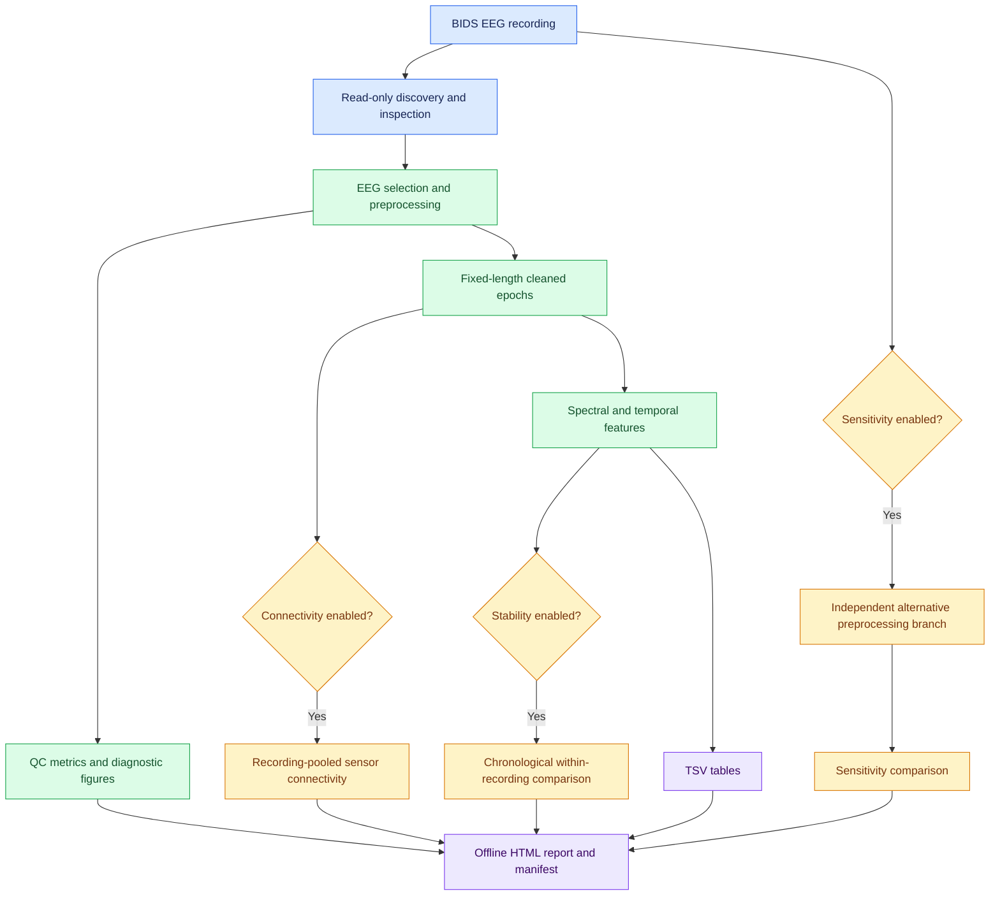
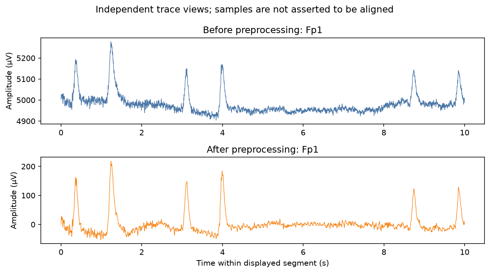
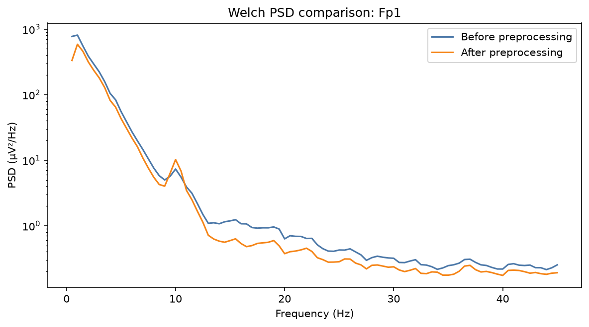
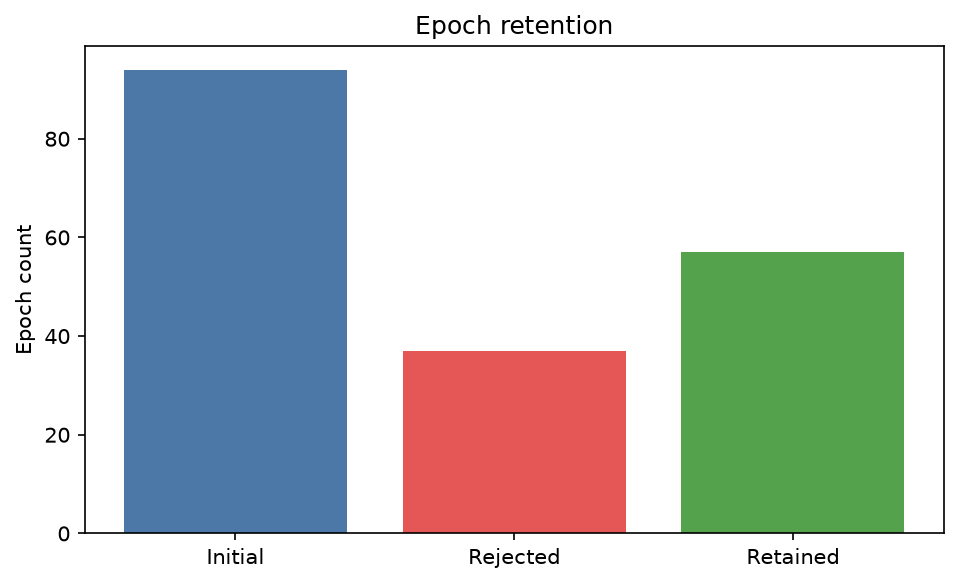
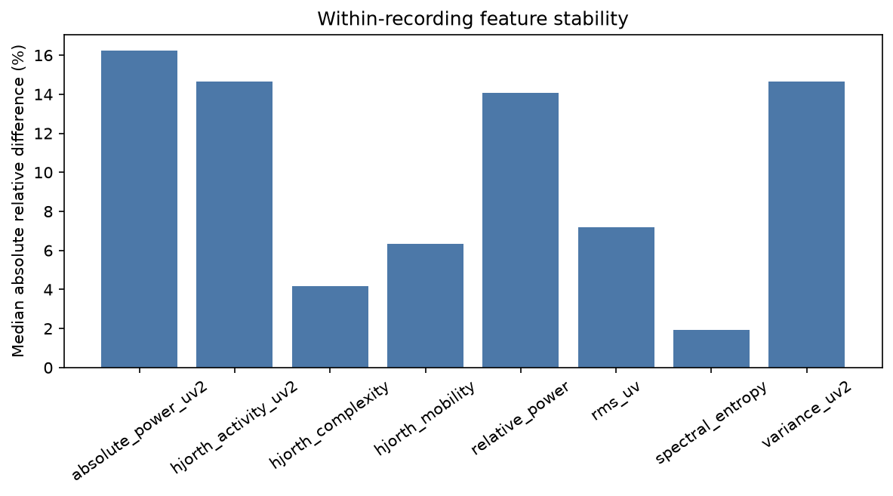

# eeg-feature-pipeline

*BIDS-native EEG preprocessing, feature extraction, connectivity, and reliability analysis*

`eeg-feature-pipeline` is a research-focused Python pipeline for BIDS-native
resting-state EEG preprocessing, sensor-level feature extraction, within-recording
feature stability, preprocessing sensitivity, quality control, and offline
reporting. The supported modality is EEG.

## Features

- Read-only BIDS EEG discovery, selection, metadata inspection, and MNE-BIDS loading.
- Configurable filtering, resampling, rereferencing, explicit EEG-channel selection,
  conservative bad-channel screening, guarded EOG-informed ICA, and fixed-length
  epoch rejection.
- Welch spectral power, absolute and relative band power, normalized spectral
  entropy, RMS, variance, and Hjorth parameters.
- Recording-pooled sensor-space magnitude-squared coherence, PLI, and debiased
  squared wPLI.
- Descriptive within-recording feature stability and an optional one-parameter
  preprocessing sensitivity comparison.
- QC JSON, diagnostic PNGs, pipeline-specific tables and FIF files, a self-contained
  HTML report, configuration snapshot, and execution manifest.
- Collision-safe, single-recording execution with derivative-style organization.

## Workflow



Optional branches are controlled by the validated YAML configuration. One command
processes exactly one selected recording; the pipeline does not implicitly batch an
entire dataset.

## Installation

Python 3.10 through 3.13 is supported. From the project directory on Windows
PowerShell:

```powershell
python -m venv .venv
.venv\Scripts\python -m pip install -e ".[dev]"
```

On POSIX systems, replace `.venv\Scripts\python` with `.venv/bin/python`.
Runtime and development dependencies are declared in `pyproject.toml`.

Verify a development installation with:

```powershell
.venv\Scripts\python -m pytest
.venv\Scripts\ruff check .
.venv\Scripts\ruff format --check .
```

## Quick start

Copy `configs/default.yaml`, then set `dataset.root` and
`dataset.derivatives_root`. Relative paths are resolved from the configuration
file. Selectors in the CLI override selectors in YAML.

```powershell
eeg-feature-pipeline validate-config --config config.yaml
eeg-feature-pipeline list-recordings --config config.yaml
eeg-feature-pipeline inspect-recording --config config.yaml --participant 01
eeg-feature-pipeline run --config config.yaml --subject 01
```

The selection must resolve to exactly one EEG recording. Use `--session`, `--task`,
and `--run` when needed. Output commands refuse to replace known files unless
`--overwrite` or `reporting.overwrite: true` explicitly permits it.

Standalone commands remain available:

```text
preprocess             extract-features       analyze-stability
analyze-sensitivity    qc                     version
```

Run `eeg-feature-pipeline COMMAND --help` for command-specific options.

## Configuration

[`configs/default.yaml`](configs/default.yaml) documents every supported setting;
[`configs/example_real_eeg.yaml`](configs/example_real_eeg.yaml) records the public
demonstration. Important controls include:

- `preprocessing`: passband, notches, target sampling rate, reference, and optional
  `eeg_channels` subset. Signal-dependent Nyquist checks occur after loading.
- `artifacts`: flat/noisy channel screening, peak-to-peak epoch rejection, and
  conservative ICA parameters. Amplitude thresholds use microvolts.
- `epochs`: fixed duration, overlap, and `BAD` annotation exclusion.
- `features`: analysis range, nonoverlapping bands, Welch window and overlap, and
  selected spectral/temporal features.
- `connectivity`, `reliability`, and `sensitivity`: optional analyses and their
  minimum-data rules.
- `reporting`: QC, figures, DPI, and overwrite policy.

An explicit channel subset is useful when a dataset labels auxiliary external
electrodes as EEG. Requested names must exist and be typed as EEG; the source file
is never changed. YAML words such as `off` should be quoted when used as BIDS entity
values.

## Inputs and outputs

Input must be a BIDS dataset with `dataset_description.json` and an EEG format
supported by MNE-BIDS. A minimal layout is:

```text
dataset/
|-- dataset_description.json
`-- sub-01/
    `-- eeg/
        |-- sub-01_task-rest_eeg.edf
        |-- sub-01_task-rest_eeg.json
        `-- sub-01_task-rest_channels.tsv
```

A unified run normally writes:

```text
derivatives/eeg-feature-pipeline/
|-- dataset_description.json
`-- sub-01/[ses-...]/eeg/
    |-- sub-01_..._desc-cleaned_epo.fif
    |-- sub-01_..._desc-spectral_features.tsv
    |-- sub-01_..._desc-temporal_features.tsv
    |-- sub-01_..._desc-connectivity_features.tsv
    |-- sub-01_..._desc-stability_features.tsv
    |-- sub-01_..._desc-stability_summary.json
    |-- sub-01_..._desc-qc_metrics.json
    |-- sub-01_..._desc-processing_config.json
    |-- sub-01_..._desc-execution_manifest.json
    |-- sub-01_..._desc-report.html
    `-- figures/
```

Session, task, acquisition, run, and recording entities are retained where present.
The root `dataset_description.json` is BIDS derivative metadata. The MNE FIF,
custom tables, QC files, figures, manifest, and report are pipeline-specific; this
project does not claim that every output is a standardized BIDS derivative datatype.
Files are staged before publication, and the successful manifest is written last.

## Scientific methodology

Processing copies the input, selects EEG (and retains EOG for artifact evidence),
screens existing/flat/robustly noisy channels, filters, rereferences, optionally
applies ICA, resamples with MNE anti-alias filtering, and creates fixed-length
epochs without event-related baseline correction. Existing and detected bad
channels remain distinct; channels are not silently interpolated.

ICA is disabled by default. When enabled, it fits a sufficiently high-passed copy,
excludes bad channels, and uses a deterministic seed. Components are removed only
when valid EOG-informed evidence satisfies the configured criterion. Missing EOG,
insufficient data, failures, and convergence concerns are reported without claiming
artifact correction.

Welch PSD uses Hamming windows, mean aggregation, DC removal, and configured overlap.
PSD is V^2/Hz internally. Absolute band power is trapezoidal integration in
microvolts squared. Relative power divides by integrated power across the complete
analysis range, not by the sum of selected bands. Spectral entropy is base-2 Shannon
entropy of nonnegative PSD bins normalized by `log2(number of bins)`.

RMS is reported in microvolts. Variance and Hjorth activity use population variance
(`ddof=0`) in squared microvolts. Hjorth mobility uses the variance of the first
discrete difference relative to signal variance; complexity compares first- and
second-difference mobility. Undefined quantities remain `NaN`.

Connectivity is pooled across all retained epochs. MNE magnitude coherence is
explicitly squared for magnitude-squared coherence; PLI and debiased squared wPLI
are used as returned by MNE-Connectivity. Values are band-averaged per channel pair,
not duplicated as per-epoch observations. These sensor-space statistics are neither
anatomical nor source-level connectivity and are sensitive to volume conduction,
reference, retained data, and estimator assumptions.

Within-recording stability splits retained epoch indices chronologically around the
recording midpoint. A boundary window is omitted when necessary so the two groups
do not share time, although overlapping epochs within each group remain dependent.
It reports group means, absolute differences, relative differences against the
first group, and guarded Spearman summaries. This is not intersession test-retest
reliability or ICC.

Sensitivity is disabled by default. When requested, one alternative filter passband
is applied independently to an unchanged source copy and compared on matched feature
rows where possible. Differences describe dependence on preprocessing, not
biological accuracy.

## Real-data demonstration

The technical example uses OpenNeuro **ds002778 v1.0.5**, “UC San Diego Resting
State EEG Data from Patients with Parkinson's Disease,” CC0, DOI
[10.18112/openneuro.ds002778.v1.0.5](https://doi.org/10.18112/openneuro.ds002778.v1.0.5).
Only public recording `sub-pd6/ses-off/task-rest` is used; no demographic or
disease-group interpretation is made. The subject-specific download contains 19
files (30.3 MB) covering the participant's `off` and `on` sessions. The demonstration
processes only `ses-off`.

The acquisition is a 191.0-second BioSemi BDF at 512 Hz with 40 channels labeled
EEG and one stimulus channel. The example explicitly selects the 32 named scalp
sensors and excludes `EXG1`-`EXG8` from analysis. It applies 1-45 Hz filtering,
average reference, 250 Hz resampling, 4-second epochs with 2-second overlap, and a
200 microvolt peak-to-peak rejection criterion. Because the sidecar declares no EOG
channels, ICA is disabled. The 45 Hz low-pass excludes the reported 60 Hz mains
frequency, so a redundant notch is not applied.

Actual run summary:

| Result | Observed value |
|---|---:|
| Candidate / retained / rejected epochs | 94 / 57 / 37 |
| Automatically detected bad channels | 0 |
| Spectral table | 10,944 rows x 12 columns |
| Temporal table | 1,824 rows x 11 columns |
| Connectivity table | 4,960 rows x 14 columns |
| Stability matches | 512 feature summaries |
| Stability groups | 24 and 33 retained epochs |

The completed manifest contains one connectivity caution: at the 1 Hz lower edge,
the delta estimator has four cycles per four-second epoch. This does not invalidate
the finite estimate, but it limits frequency resolution and interpretation.

Median values across retained epochs and 32 channels:

| Band | Absolute power (microvolts squared) | Relative power |
|---|---:|---:|
| Delta (1-4 Hz) | 24.877 | 0.4409 |
| Theta (4-8 Hz) | 7.004 | 0.1223 |
| Alpha (8-13 Hz) | 12.165 | 0.2157 |
| Beta (13-30 Hz) | 6.423 | 0.1220 |
| Gamma (30-45 Hz) | 1.275 | 0.0215 |

Median normalized spectral entropy was 0.7259 and median RMS was 8.428 microvolts.
Across feature-family summaries, median relative differences between the two
chronological groups ranged from 1.94% to 16.24%; guarded Spearman correlations
ranged from 0.869 to 0.974. These are descriptive values from one recording with
overlapping windows, not population findings or test-retest estimates. Full methods,
sanity checks, and provenance are recorded in
[`docs/real-data-demonstration.md`](docs/real-data-demonstration.md).



The traces are independent views and are not asserted to be sample-aligned after
filtering, rereferencing, and resampling.



The PSD panel shows actual estimates over the shared 1-45 Hz range; amplitude
reduction is not interpreted as physiological improvement.





To reproduce the example, install the small acquisition utility separately, fetch
only the documented participant subset, and run the pinned configuration:

```powershell
.venv\Scripts\python -m pip install openneuro-py
.venv\Scripts\python -c "import openneuro; openneuro.download(dataset='ds002778', tag='1.0.5', target_dir='data/ds002778', include=['sub-pd6'])"
eeg-feature-pipeline validate-config --config configs/example_real_eeg.yaml
eeg-feature-pipeline inspect-recording --config configs/example_real_eeg.yaml
eeg-feature-pipeline run --config configs/example_real_eeg.yaml --subject pd6 --session off --task rest
```

The generated HTML report is intentionally ignored by version control because it
is reproducible and contains recording-level outputs. After running, open
`derivatives/example-real-eeg/eeg-feature-pipeline/sub-pd6/ses-off/eeg/` and select
the file ending in `_desc-report.html`.

## Validation and reproducibility

Automated tests use deterministic synthetic signals and synthetic BIDS fixtures to
exercise configuration, ingestion, preprocessing, features, connectivity,
stability, sensitivity, QC, reporting, safe writing, and CLI integration. The
public-data run above additionally demonstrates execution on one genuine recording;
it is not broad external validation.

The final local audit ran 92 tests. The real-data execution environment recorded
Python 3.12.7, MNE 1.13.2, MNE-BIDS 0.20.0, MNE-Connectivity 0.9.0, NumPy 2.5.4,
SciPy 1.18.1, and Pandas 2.3.3. Supported dependency ranges remain authoritative in
`pyproject.toml`; this one environment is not a claim of testing every allowed
combination.

The effective configuration is `configs/example_real_eeg.yaml`. Each run stores a
redacted configuration snapshot, source-relative recording identifier, pipeline and
dependency versions, UTC timestamp, enabled-stage statuses, deterministic ICA seed,
warnings, output paths, and a completion manifest. Raw downloads and full local
derivatives remain ignored. The four committed PNGs were copied unchanged from the
completed real-data run.

No participant-group comparison, diagnostic modeling, hypothesis test, source
reconstruction, anatomical connectivity inference, or clinical-utility assessment
was performed.

## Limitations

- Configuration validation cannot replace visual review or signal-level scientific
  judgment. The automatic bad-channel metrics are intentionally simple.
- The public dataset release labels eight `EXG` channels as EEG and supplies no
  electrode-coordinate files for this recording. The example's 32-channel subset is
  therefore an explicit analysis choice, not a source-data correction.
- ICA was not evaluated in the real-data example because no channel was typed EOG.
- A 39.36% epoch-rejection fraction and prominent frontal transients show that this
  is not a claim of artifact-free data. No visual manual rejection was performed.
- Overlapping epochs are statistically dependent. Pooled connectivity and stability
  summaries must not be treated as independent epoch observations.
- Sensor-space connectivity is reference- and volume-conduction-sensitive.
- Sensitivity analysis compares only one alternative filter passband and is not a
  comprehensive robustness study.
- MEG, intracranial EEG, source reconstruction, and other modalities are outside
  the implemented EEG scope.
- Results from one public recording do not establish generalizability, clinical
  validity, or performance across devices, populations, or recording protocols.
- Custom result tables and MNE FIF files are not claimed as universally standardized
  BIDS Derivatives datatypes.

Potential extensions include carefully reviewed dataset-level execution and richer
derivative metadata, but they are outside the current single-recording scope.

## License and citation

**Author:** Isha Vats

The software is released under the [MIT License](LICENSE), copyright 2026 Isha
Vats. Citation metadata are provided in [`CITATION.cff`](CITATION.cff). No software
DOI, institutional affiliation, or publication is claimed. Dependency packages
retain their own licenses, and the MIT software license does not replace the CC0
license of the externally hosted demonstration dataset.

When using the demonstration data, cite the dataset DOI above and follow the data
authors' citation guidance in its README. The dataset description credits Alexander
P. Rockhill, Nicko Jackson, Jobi George, Adam Aron, and Nicole C. Swann. The pipeline
uses [MNE-Python](https://mne.tools/),
[MNE-BIDS](https://mne.tools/mne-bids/), and
[MNE-Connectivity](https://mne.tools/mne-connectivity/); cite those projects as
appropriate. No software DOI has been assigned.
